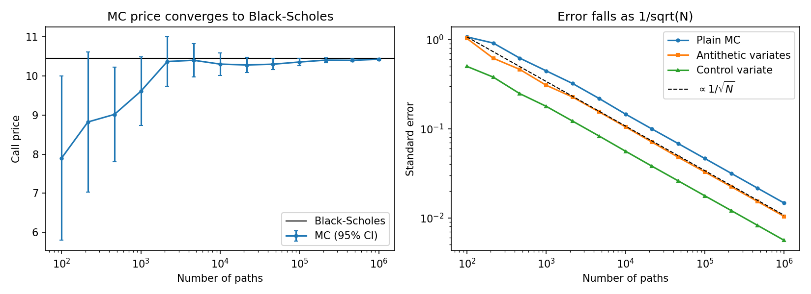
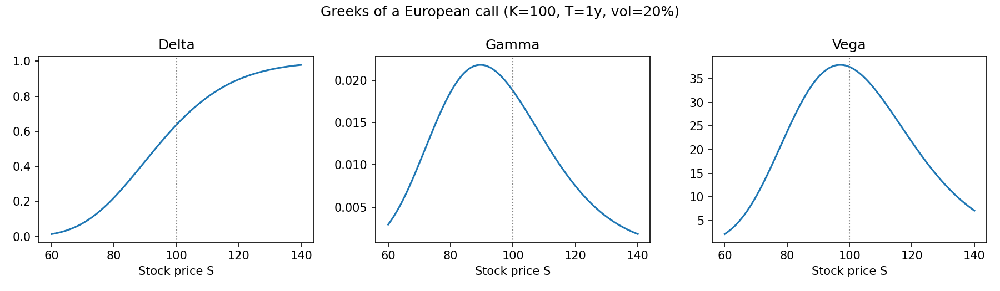

# Option Pricing & Portfolio Risk

Pricing European options with Black–Scholes and Monte Carlo, and (coming next) measuring portfolio risk with Value-at-Risk and Expected Shortfall. Made with help of Claude AI from financial side and writing the documentation (I know you get it).
## Part 1 — Option pricing (done)

- Analytic **Black–Scholes** prices and Greeks (delta, gamma, vega, theta, rho).
- **Monte Carlo** pricing under geometric Brownian motion, with standard errors.
- **Antithetic variates** as a variance-reduction technique.

### Key results (ATM call: S = K = 100, T = 1 year, r = 5%, σ = 20%)

| Method | Price |
|---|---|
| Black–Scholes | 10.4506 |
| Monte Carlo, 10⁶ paths | 10.428 ± 0.015 |

- The Monte Carlo error falls as 1/√N, as expected from the central limit theorem.
- Antithetic variates halve the variance at no extra computational cost.




## Part 2 — Portfolio risk (in progress)

- 1-day 99% VaR and Expected Shortfall for an equity portfolio (historical, parametric, Monte Carlo).
- Backtest with the Kupiec test.

## How to run

```bash
pip install -r requirements.txt
python scripts/01_pricing.py   # prints results, saves figures to figures/
pytest                         # checks against textbook values and put-call parity
```

## Structure

```
src/pricing.py        Black–Scholes, Greeks, Monte Carlo
scripts/01_pricing.py convergence study and Greeks plots
tests/                unit tests
figures/              generated plots
```
