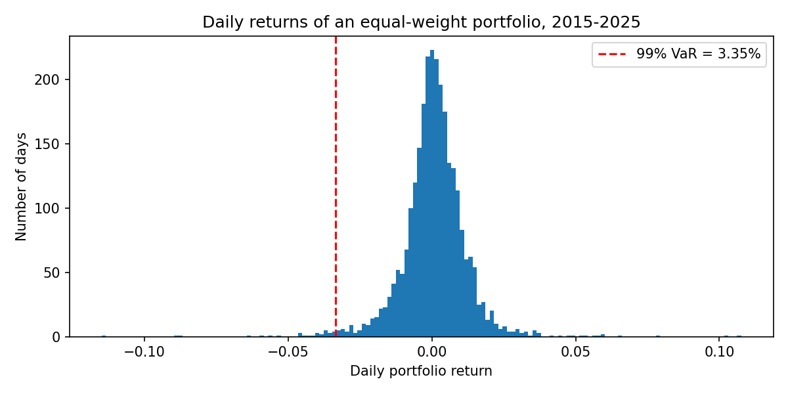
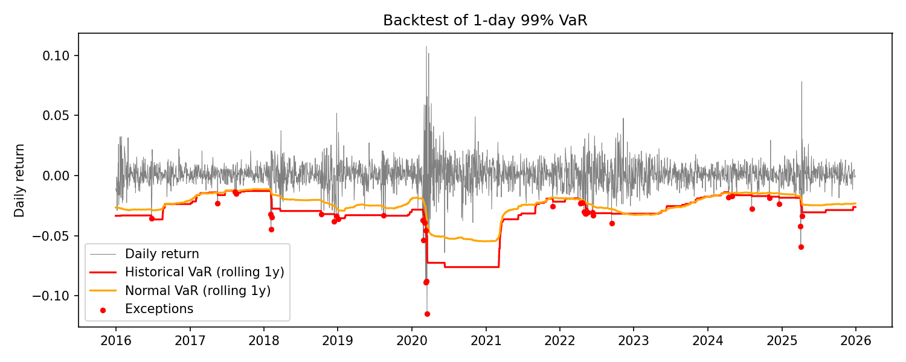

# Option Pricing & Portfolio Risk

Pricing European options with Black–Scholes and Monte Carlo, and measuring portfolio risk with Value-at-Risk and Expected Shortfall. Made with help of Claude AI from financial side and writing the documentation (I know you get it).
## Part 1 — Option pricing (done)

- Analytic **Black–Scholes** prices and Greeks (delta, gamma, vega, theta, rho).
- **Monte Carlo** pricing under geometric Brownian motion, with standard errors.
- **Antithetic variates** as a variance-reduction technique.

### Key results (ATM call: S = K = 100, T = 1 year, r = 5%, σ = 20%)

| Method | Price |
|---|---|
| Black–Scholes | 10.4506 |
| Monte Carlo, 10⁶ paths | 10.428 ± 0.015 |

- The Monte Carlo error falls as 1/√N, as expected from the central limit theorem.
- Antithetic variates halve the variance at no extra computational cost.


## Part 2 — Portfolio risk

Equal-weight portfolio of AAPL, MSFT, JPM, XOM and JNJ, daily prices 2015–2025
(2,764 trading days, Yahoo Finance). Risk figures for a $1M portfolio.

| Method | 1-day 99% VaR | 1-day 99% ES |
|---|---|---|
| Historical | 3.35% ($33,539) | 4.81% ($48,134) |
| Parametric (normal) | 2.67% ($26,669) | 3.07% ($30,664) |

### Findings
- **Fat tails.** Daily returns have an excess kurtosis of 13.5. The normal model
  underestimates the 99% VaR by about 20%, and real losses exceeded it on 57 days
  instead of the expected 28.
- **Volatility clustering.** The worst day (−11.48%, 16 March 2020) came just three
  days after the best day (+10.76%, 13 March 2020).
- **Backtest.** VaR estimated on a rolling 250-day window and compared with the
  next day's return (2,514 days, 25 exceedances expected). Historical VaR had
  37 exceedances (1.47%, Kupiec p = 0.026) and normal VaR 61 (2.43%, p < 0.001):
  both models are rejected at the 5% level. Exceedances cluster in crises such as
  March 2020, when a one-year window adapts too slowly to rising volatility.
- **Possible extension:** volatility-weighted VaR (EWMA or GARCH) that reacts
  faster to changes in market regime.





## How to run

```bash
pip install -r requirements.txt
python scripts/01_pricing.py   # prints results, saves figures to figures/
pytest                         # checks against textbook values and put-call parity
python scripts/02_risk.py      # VaR, ES and backtest; saves figures
```


## Structure

```
src/pricing.py        Black–Scholes, Greeks, Monte Carlo
scripts/01_pricing.py convergence study and Greeks plots
tests/                unit tests
figures/              generated plots
```
